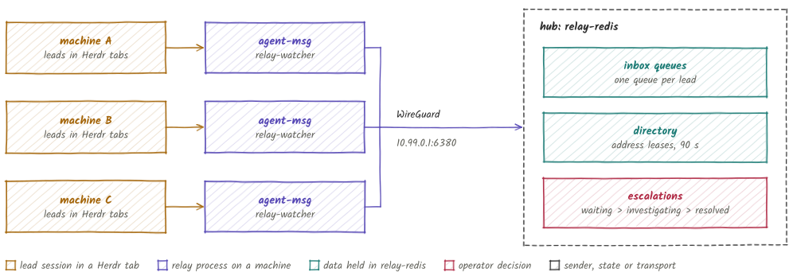
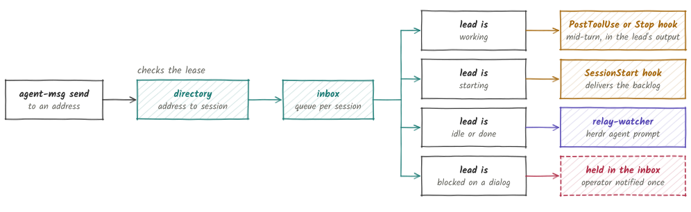
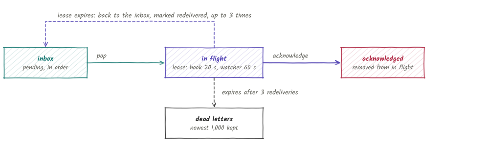

# ix-relay

ix-relay is a message bus that lets AI coding-agent team leads on different machines message each other.

Each lead runs in a Herdr tab under Claude Code, Codex or opencode. On every machine, `agent-msg` sends and reads messages, and `relay-watcher` types queued messages into idle leads. The queues, the address directory and an escalation inbox for decisions that need a human live in one Redis, relay-redis, on a hub machine that every other machine reaches over WireGuard. Only leads use the bus; subagents report through their harness.

<picture>
  <source media="(prefers-color-scheme: dark)" srcset="docs/images/topology-dark.svg">
  
</picture>

> **Status: public prerelease.** Commands, the Redis key layout and the plugins are
> still changing. Expect breaking changes.

## Addressing

A lead is identified by its `server:workspace:tab`, using the current Herdr labels. All three parts are required in a full address. The relay discovers and enrolls the live lead behind an address, so a sender needs no registration step first.

| Form | Meaning |
|---|---|
| `server:workspace:tab` | the lead in that tab on that server |
| `:workspace:tab` | the same, on the sender's server |
| `:tab` | the same, in the sender's server and workspace |
| `all` | every registered lead except the sender |

Matching ignores case. Quote an address that contains spaces. Renames and moves change the address, and the session keeps its queue. Nicknames, bare names, raw pane IDs and `AGENT_MSG_NAME` do not route messages. Two live sessions in one tab are rejected.

## How a message is delivered

`agent-msg send` looks the address up in the directory in Redis, then queues the message in the recipient's inbox. How it reaches the lead depends on what the lead is doing.

<picture>
  <source media="(prefers-color-scheme: dark)" srcset="docs/images/delivery-dark.svg">
  
</picture>

A send prints the recipient's state after `queued for`, for example `queued for hub:team:code (watcher heartbeat from hub (last tick 3s ago), 1 waiting)`. [How it works](docs/how-it-works.md) describes the directory leases, enrollment and the hooks.

## Delivery guarantees

Delivery is at-least-once. A pop moves a batch into the lead's in-flight record under a lease. The recipient acknowledges the batch after it is written to the harness. A batch that is not acknowledged returns to the front of the inbox when its lease expires, and its signature line says `(redelivered)`.

<picture>
  <source media="(prefers-color-scheme: dark)" srcset="docs/images/lifecycle-dark.svg">
  
</picture>

| Limit | Value |
|---|---|
| Hook lease | 20 s |
| Watcher lease | 60 s |
| Redeliveries before a dead letter | 3 |
| Unacknowledged batches per lead | 16 |
| Unacknowledged bytes per lead | 1 MiB |
| Dead letters kept per lead | 1,000, newest first |
| Message size | 4 KiB |

`agent-msg inbox --dead` lists dead letters, and `agent-msg inbox --in-flight` lists every lead that has in-flight batches or dead letters.

## Install

Build both binaries and put them on `PATH`:

```bash
cargo install --git https://github.com/agent-ix/ix-relay agent-msg --locked
cargo install --git https://github.com/agent-ix/ix-relay relay-watcher --locked
```

Install the plugin in each lead's harness:

```bash
# Claude Code
claude plugin marketplace add agent-ix/ix-relay
claude plugin install ix-relay@ix-relay
```

The [Codex plugin](plugins/codex/README.md) and the [opencode plugin](plugins/opencode/README.md) have their own steps. A machine also needs a WireGuard tunnel to the hub, a bus URL in `~/.ix/relay/config.toml`, and a running watcher. [Setup](docs/setup.md) covers the hub, adding a machine and checking health.

## Usage

```bash
agent-msg whoami                         # this session's verified address
agent-msg send :workspace:tab "text"     # send to one lead
agent-msg send all "text"                # send to every other lead
agent-msg inbox                          # print and remove pending messages
agent-msg who                            # registered leads
agent-msg find [query]                   # live leads by address, label or session
agent-msg log --since 1h                 # message history
agent-msg doctor                         # read-only health check; exits 1 on a failure
```

A lead escalates a decision that only the operator can make, then keeps working:

```bash
agent-msg escalate <ticket> --context "<what needs deciding>" \
  --option "<choice>" --option "<choice>" --recommend "<choice>"
agent-msg escalations --status waiting
agent-msg investigate <id>
agent-msg resolve <id> "<decision>"
```

[Escalations](docs/escalations.md) describes the full flow and the `relay-tui` inbox. The [CLI reference](docs/cli-reference.md) lists every command and flag, including lane focus, server capacity, program-review status requests and the work report.

## Components

| Component | Description |
|---|---|
| `crates/agent-msg` | The `agent-msg` CLI and the Claude and Codex hook handler. |
| `crates/relay-watcher` | One process per machine. Delivers to idle leads, publishes the directory and pushes OTLP metrics. |
| `crates/relay-tui` | `relay-tui`, the operator's escalation inbox, and `team-leader-dashboard`, a monitor for one lead session. |
| `crates/relay-core` | Redis store, message, registration, directory and escalation types. |
| `crates/relay-ops` | Operations shared by the binaries: enrollment, escalation, Herdr checks and Linear posting. |
| `crates/claude-wire` | Typed Claude Code cross-session wire formats, with drift detection and no I/O. |
| `crates/herdr-cli` | Shared Herdr process and JSON plumbing. |
| `plugins/claude`, `plugins/codex`, `plugins/opencode` | Harness plugins and lead guidance. |
| `helm/` | The relay-redis chart and the `agent-spend-dashboard` chart. |
| `deploy/` | systemd and launchd units for `relay-watcher` and the Redis forwarder. |
| `scripts/relay-admin` | Hub administration: WireGuard, peers and Redis users. |

## Documentation

- [How it works](docs/how-it-works.md): directory leases, enrollment, hooks, the watcher and stranded mail.
- [Setup](docs/setup.md): the hub, adding a machine, the watcher and health checks.
- [Configuration](docs/configuration.md): `config.toml`, environment variables and state files.
- [Escalations](docs/escalations.md): filing, investigating and resolving.
- [Observability](docs/observability.md): OTLP metrics and the agent-spend dashboard.
- [CLI reference](docs/cli-reference.md): every command and flag.
- [Requirements](spec/spec.md) and the [directory state model](spec/reviews/relay-directory-state-model.md).
- [Release notes](CHANGELOG.md).

## Contributing

Build and test with `make test`. `make test-redis` runs every test against a throwaway `redis:7` container and needs Docker. `make ci` runs every gate: formatting, clippy, tests, `cargo deny`, the unsafe-comment audit, docs and the spec matrix check. The matrix check needs `python3`.

Regenerate the figures with the docs-figures skill from `agent-ix/dev-tools`:

```bash
python3 <dev-tools>/skills/docs-figures/scripts/render.py docs/images/figures.py
```

## License

AGPL-3.0-or-later. See [LICENSE](LICENSE).
