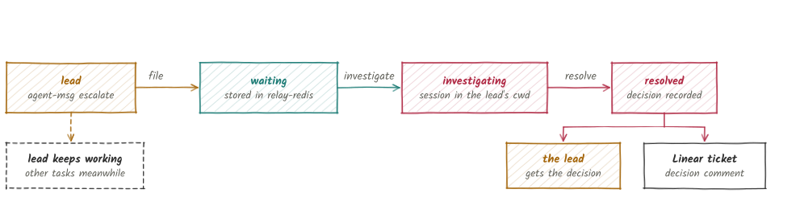

# Escalations

An escalation is a request for a decision that only the operator can make. A lead files one, keeps working on other tasks, and receives the decision over the bus. Escalations are stored in Redis separately from message inboxes.

<picture>
  <source media="(prefers-color-scheme: dark)" srcset="images/escalation-dark.svg">
  
</picture>

A lead escalates only for a decision that is the operator's to make. It states the options it sees and its own recommendation. An escalation has one of three states, and its status moves forward only:

| State | Meaning |
|---|---|
| `waiting` | Filed. Nobody has started on it. |
| `investigating` | A session is open on it. |
| `resolved` | A decision was recorded. The state is final, and `investigate` and `resolve` refuse a resolved escalation. |

## File an escalation

```bash
agent-msg escalate <ticket> --context "<what needs deciding>" \
  --option "<choice>" --option "<choice>" --recommend "<choice>"
```

The command prints the escalation ID, for example `e7`. `--option` can repeat. The command refuses when the calling session is not registered or has no recorded session ID. It also sends the configured human a short pointer message that never contains the context, options or recommendation.

## Review escalations

```bash
agent-msg escalations                       # every state
agent-msg escalations --status waiting
agent-msg escalation show <id>              # full detail
```

`escalation show` prints the ticket, lead, machine, working directory, harness kind, status, context, options, recommendation and decision.

`relay-tui` is the operator's inbox for the same data. Its keys are `j`/`k` to move, `Tab` to filter, `i` to fork the lead's session, `I` to start a fresh session, `r` to resolve, `p` to retry the Linear post and `q` to quit. `relay-tui --notify` shows one Herdr notification for each newly arrived waiting escalation, and never for the backlog present at start-up. The default is no notification.

## Investigate

```bash
agent-msg investigate <id>            # fork the lead's own Claude Code session
agent-msg investigate <id> --fresh    # start a fresh session with a fixed prompt
```

Investigate opens a Claude Code session on the lead's machine, in the lead's working directory, and moves the escalation to `investigating`. The fork path resumes the lead's session with `--fork-session` and works only for a Claude Code lead. Leads of any other kind need `--fresh`.

## Resolve

```bash
agent-msg resolve <id> "<decision>"
```

Resolve records the decision, sends it to the lead over the bus and posts it as a comment on the Linear ticket. The Linear post uses the `linear` CLI on the machine that runs `resolve`, normally the operator's machine. If the post fails, the escalation still moves to `resolved` and the lead is still notified. The command prints the failure and the retry command:

```bash
agent-msg escalation post-linear <id>
```

## The human name

`escalate` and `resolve` sign the human side as `operator`. Set `human` in `config.toml`, `IX_RELAY_HUMAN` or `--human` to change it.

## Text handling

Escalation text passes through no shell and no terminal escape-sequence interpreter. The fresh-session prompt of `investigate --fresh` is a fixed string built from the escalation ID, the lead's name and the ticket. The fresh session reads the lead-supplied text itself with `agent-msg escalation show <id>`. `escalate` also rejects control characters other than newline and tab.
