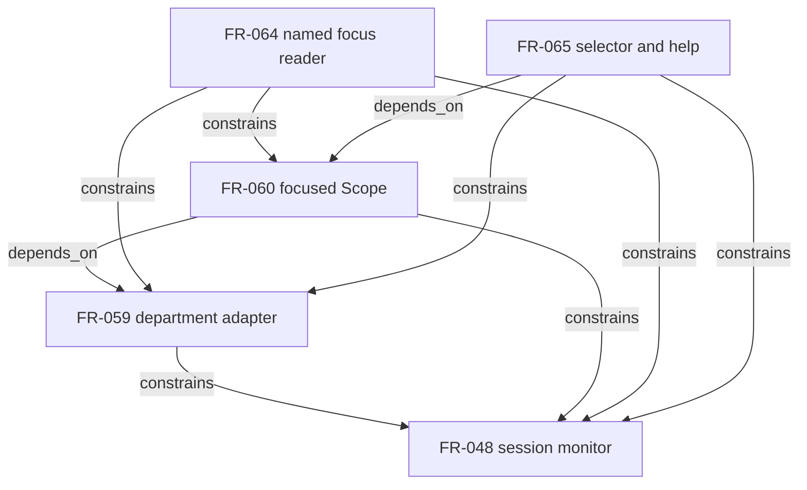

## Summary

Ticket: SWM-179. Spec-only change at frozen head df58008 (base 86d94d7). Dependency and ordering analysis of FR-065's relationship edges, its Dependencies section and its Precedence statements against FR-048, FR-059, FR-060, FR-064 and the canonical dev-team FR-004 that FR-059 depends on. The graph is acyclic and FR-065 does not wait on any unimplemented named-focus work, which is right for a small navigation change. 3 findings: 2 medium, 1 low.

## Verdict

**CONDITIONAL** - no `high` finding, no cycle, no hidden prerequisite that blocks the capability. The defects are that FR-065 overrides statements in FR-060 without the edge and the Precedence entry the repo uses for that, that it names FR-064 as a dependency while verifying a key FR-064 has not delivered, and that it authors Status text over content a canonical requirement in another repo owns.

## Findings

| ID | Severity | Summary | Refs |
|---|---|---|---|
| FND-001 | medium | FR-065 overrides FR-060 statements (Scope fixtures change only for rows, labels and key; Tickets, Agents and department views unchanged) but has only depends_on FR-060, no edge to FR-064, and no Precedence entry for them | spec/functional/FR-065-dashboard-view-selector-and-help.md:10 |
| FND-002 | low | The Status purpose line is relay-local text over content owned by dev-team FR-004, with no edge to it and wording that differs from its Status list | spec/functional/FR-065-dashboard-view-selector-and-help.md:128 |
| FND-003 | medium | FR-064 is listed under Dependencies for the f key although it is not a prerequisite, and AC-3 and AC-4 verify an f key that no code handles yet | spec/functional/FR-065-dashboard-view-selector-and-help.md:167 |

## Review Context

Reviewer model claude-sonnet-5-5; the reviewer's own harness session ID was not visible, so none is claimed; run id unavailable. Root-supplied marker metadata: repository visibility public, quoin 0.36.7, module spec-artifacts-process@v0.29.2. The PR number was not supplied; the marker carries the placeholder `unavailable`. Marker id=SR-120 method=spec-review/dependency lang=spec.

What was and was not run. I read the quoin 0.29.4 spec-dependency-analysis skill, the relationship frontmatter and Dependencies sections of FR-048, FR-059, FR-060 and FR-064, the cached dev-team FR-004 (a cross-repo requirement, read for context and not listed in the machine scope because it has no path in this repository), and FR-065. Read, Glob, Grep, Edit and Write only; I ran no quire, quoin or git command and the analysis is a manual graph, not a validation result. The `quire validate` check of relationship targets is the parent's. The Jev client and criterion-strength analysis were not used. No AssuranceProfile exists under spec/.

### Classification and graph

| Requirement | Class | Rationale |
|---|---|---|
| FR-048 | Feature | Session-bound views and keys; the base of the chain |
| FR-059 | Feature | Department views and startup modes; constrains FR-048 |
| FR-060 | Feature | Focused Scope view; constrains FR-048, depends on FR-059 |
| FR-064 | Feature (spec only) | Named-focus Scope; constrains FR-048, FR-059, FR-060; depends on FR-061 to FR-063 and ix-board FR-012 |
| FR-065 | Feature | Navigation and labels over the six views; constrains FR-048, FR-059; depends on FR-060 |

No enablement requirement is introduced and none is missing: FR-065 adds no schema, library or data source.



Topological order for implementation: FR-048, FR-059, FR-060 (all delivered), then FR-065. FR-064 and FR-061 to FR-063 are not prerequisites of FR-065 and must not become one (see FND-003). Cycles: none in the frontmatter edges. FR-048 and FR-059 now cite FR-065 in their Dependencies prose while FR-065 constrains them; that follows the existing cross-listing idiom (FR-048 lists FR-059 and FR-061 to FR-064 and FR-059 lists FR-048), so I did not raise it.

Checks that held: every FR-065 frontmatter target resolves to an existing relay requirement; `constrains` for FR-048 and FR-059 matches the Precedence section's overrides of FR-048-AC-4 and FR-059-AC-4; FR-065 takes no dependency on ix-board, credentials or any new service, matching the ticket's out-of-scope list; the FR-059 and FR-048 Dependencies edits cite FR-065 with a valid relative link.

## Examined Scope

```yaml
scope:
  - {id: "FR-065-frontmatter", path: "spec/functional/FR-065-dashboard-view-selector-and-help.md", role: examined, excerpt: "  - target: \"ix://agent-ix/ix-relay/FR-060\"\n    type: \"depends_on\""}
  - {id: "FR-065-Precedence", path: "spec/functional/FR-065-dashboard-view-selector-and-help.md", role: examined, excerpt: "For presentation of the view switch only, this requirement takes precedence over the following statements, and only to the extent listed:"}
  - {id: "FR-065-Help", path: "spec/functional/FR-065-dashboard-view-selector-and-help.md", role: examined, excerpt: "filter and focus: `c` in Scope (completed projects), and `f` where named focuses are active;"}
  - {id: "FR-065-Status-purpose", path: "spec/functional/FR-065-dashboard-view-selector-and-help.md", role: examined, excerpt: "Status SHALL show the plain-language purpose line \"Status: progress, blockers and lane activity for the selected department scope.\" It may wrap at 80 columns."}
  - {id: "FR-065-AC-3", path: "spec/functional/FR-065-dashboard-view-selector-and-help.md", role: examined, excerpt: "`f` appears only where named focuses are active."}
  - {id: "FR-065-AC-4", path: "spec/functional/FR-065-dashboard-view-selector-and-help.md", role: examined, excerpt: "With a popup open, a fixture sending every existing key (`q`, `r`, `d`, `Enter`, `s`, `e`, `t`, `a`, `p`, `1`, `2`, `3`, `c`, `f`, `j`, `k`, arrows, PageUp, PageDown)"}
  - {id: "FR-065-AC-10", path: "spec/functional/FR-065-dashboard-view-selector-and-help.md", role: examined, excerpt: "Existing FR-048-AC-1 binding, FR-059 source-failure, replacement-fence, quit, terminal-restoration and FR-060 scroll/selection/toggle fixtures pass with only the header, footer and label differences stated above."}
  - {id: "FR-065-Dependencies", path: "spec/functional/FR-065-dashboard-view-selector-and-help.md", role: examined, excerpt: "[FR-064](./FR-064-named-focus-dashboard-reader.md), the `f` key when named focuses are active."}
  - {id: "FR-048-Dependencies", path: "spec/functional/FR-048-session-work-monitor.md", role: examined, excerpt: "[FR-065](./FR-065-dashboard-view-selector-and-help.md) adds the View selector and F1 help. The `t`, `a` and `p` keys remain compatibility shortcuts."}
  - {id: "FR-059-Description", path: "spec/functional/FR-059-department-monitor-adapter.md", role: context_only, excerpt: "The canonical requirement owns the Status, Health and Retro contents;"}
  - {id: "FR-059-Dependencies", path: "spec/functional/FR-059-department-monitor-adapter.md", role: examined, excerpt: "[FR-065](./FR-065-dashboard-view-selector-and-help.md), the View selector, F1 help and department scope labels over these views."}
  - {id: "FR-060-Precedence", path: "spec/functional/FR-060-focused-scope-presentation.md", role: context_only, excerpt: "Scope fixtures change only for the rows, labels and key above."}
  - {id: "FR-064-Rows-and-navigation", path: "spec/functional/FR-064-named-focus-dashboard-reader.md", role: context_only, excerpt: "The key `f` selects the viewed scope: combined (all active focuses), then each focus in order, then combined again."}
```

## Finding details

### FND-001 (medium) FR-065 overrides FR-060 and FR-064 statements without the edge or the Precedence entry

The repo's idiom for a requirement that overrides another's statements is a `constrains` edge plus a Precedence section naming each statement: FR-060 does it for FR-048 and FR-059, FR-064 for FR-060. FR-065 does it for FR-048 and FR-059 but gives FR-060 only `depends_on`, gives FR-064 no edge, and its Precedence lists three statements, none from FR-060 or FR-064. Yet FR-060 (lines 33-35) says that for the Scope view, FR-059's "existing Scope fixtures retain their outputs" statements are limited so "Scope fixtures change only for the rows, labels and key above", and (line 40) "The Tickets and Agents views, the department views and the existing keys are unchanged". FR-065's selector row, footer and identity row change the Scope, Tickets, Agents and department fixtures, and FR-065-AC-10 allows exactly that for "FR-060 scroll/selection/toggle fixtures". Because Precedence applies "only to the extent listed", a literal reading keeps FR-060's "only" in force and FR-065-AC-10 fails against it. FR-064-AC-1 ("Scope view output identical to the FR-060 fixtures") and its Description ("unchanged in both modes") stay true only if the fixtures change together; nothing says so. FR-060 and FR-064 are unedited, so a reader of either learns nothing about FR-065.

Fix: change the FR-060 edge to `constrains`, add a `constrains` edge to FR-064, and list in Precedence the FR-060 "only" statement, the FR-060 "unchanged" sentence and the FR-064 statements that the new header, footer and identity row touch, to the extent they apply. This and SR-119 FND-003 share a repair: one list of permitted differences.

### FND-002 (low) The Status purpose line is authored over canonical content with no edge

FR-059 states "The canonical requirement owns the Status, Health and Retro contents" and depends on dev-team FR-004, whose Status list is "scoped plan progress, active/ready work, lane evidence age, configured capacity, blockers and the next owned action". FR-065 fixes a Status sentence (lines 128-129) that names three of those six items and says "lane activity" where FR-004 says "lane evidence age". FR-065 has no relationship or Dependencies entry for dev-team FR-004 and does not say the sentence is relay-local adapter text. If FR-004's Status contents change, this sentence is a second statement of them that nobody is told to update.

Fix: add the `ix://agent-ix/dev-team/FR-004` relationship and say the line is an adapter label that does not define Status content, or word the line so it points at the canonical list and drops the partial paraphrase. Severity is low because the sentence is a short label and the ticket asked for it.

### FND-003 (medium) FR-064 is a coordination reference, not a prerequisite, and the ACs treat it as delivered

Lines 167-168 list FR-064 under Dependencies "the `f` key when named focuses are active", with the same weight as FR-048, FR-059 and FR-060. FR-064 itself depends on FR-061 to FR-063 and ix-board FR-012. In the source there is no `f` handler (`handle_key`, monitor.rs:230-279 has no `'f'` arm) and the recent commit titles show only FR-061 delivered (SWM-128). FR-065 cannot be implemented after FR-064 without waiting on three unimplemented requirements, which is not what a tiny navigation change should do, and the prose does not say it is not a prerequisite. Meanwhile AC-3 asserts "`f` appears only where named focuses are active" and AC-4 sends `f` as an "existing key": no fixture can send a key nothing handles, so that part passes vacuously, and the "where active" half cannot occur until FR-064 ships.

Fix: say FR-064 is not a prerequisite, drop `f` from the AC-3 and AC-4 fixtures until named mode exists, and put the Help `f` row and its sweep entry on the delivery of FR-064, stated in FR-065 as a conditional ("when FR-064 is delivered") or in FR-064's own acceptance. Keep the edge model as it is (no `depends_on` FR-064).

## Verdict after disposition pass 1

Not run. Dispositions are reserved for this same session after the fix round.
